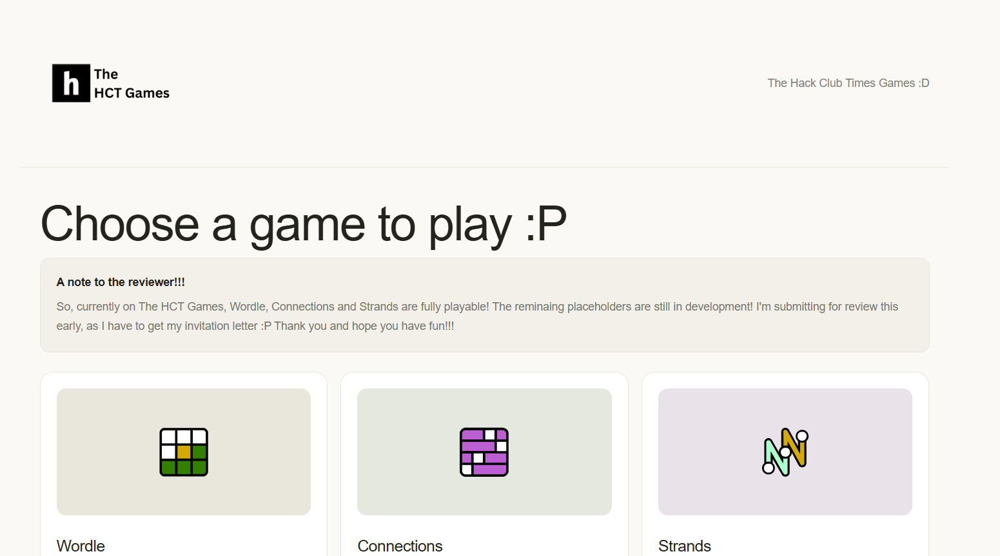
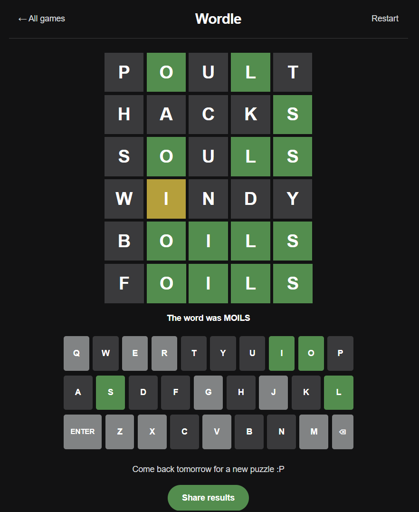
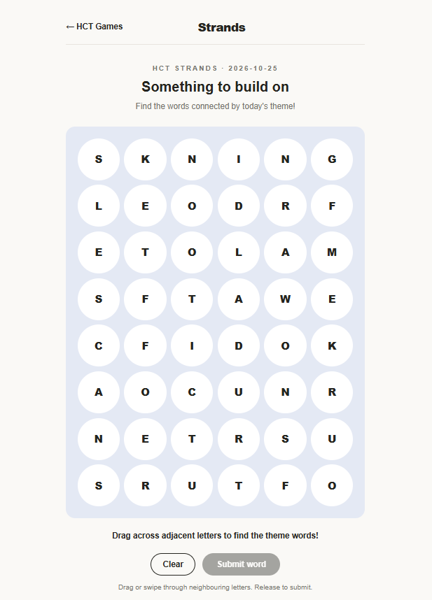

# The HCT Games

> ⚠️ Note: The HCT Games are currently in development! The fully playable  games are:
> 1. Wordle
> 2. Connections
> 3. Strands

---

## Overview
The Hack Club Time's Games are a collection of fun, little games that are also a part of the NYT Games archive! Alongside this, I also plan to add many more such mini games to the website!

<p align="center">
  
</p>

---

## Why I built this project

So the main reason I thought of making this project was because the NYT Games charge players and force them to purchase a subscription in order to play these wonderful games :(( I wanted to create a platform where I could play games like these without restrictions and freely! Another reason is that I LOVE to play mini games and having a library of games in a single place sounded like a good idea to me!

---

## Images

<p align="center">
  
</p>

<table>
  <tr>
    <td align="center">
      
    </td>
    <td align="center">
      
    </td>
  </tr>
</table>

---

## How to Build & Run

Prerequisites: [Node.js](https://nodejs.org/) and npm.

1. Clone the repository:
   ```bash
   git clone https://github.com/rawrrudy/the-hct-games
   cd lumen
   ```

2. Install dependencies:
   ```bash
   npm install
   ```

3. Start the development server:
   ```bash
   npm run dev
   ```

4. Open [http://localhost:3000](http://localhost:3000) in your browser.

Built with Next.js, TypeScript, and Tailwind CSS.

---

## License

This project has the MIT License


